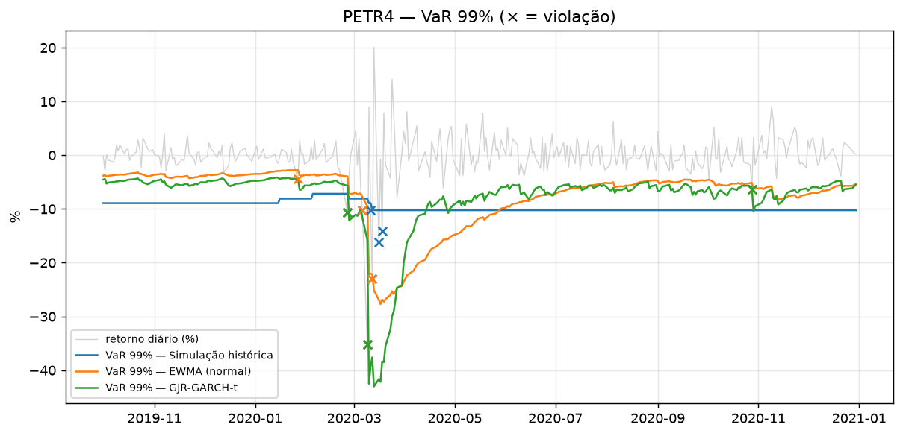
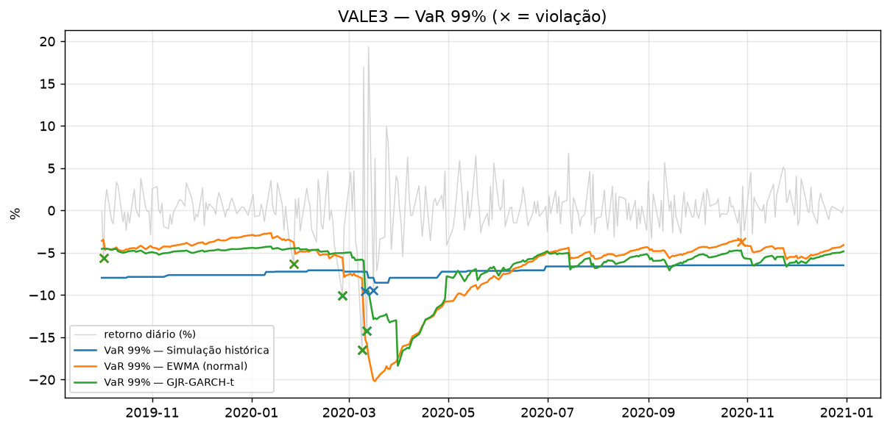
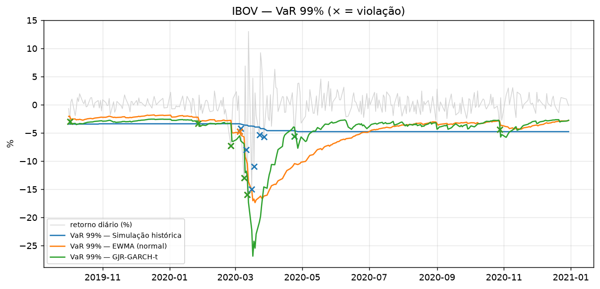

# RiskAgent B3

Baseline de **risco de mercado** para a bolsa brasileira: compara 3 modelos de VaR 99% (simulação histórica, EWMA com normal e GJR-GARCH-t) em PETR4, VALE3 e Ibovespa, com backtest fora da amostra e teste de Kupiec.

> Projeto de estudo (Fase 1 de 5). Não é recomendação de investimento.

**Fluxo:** Yahoo Finance → retornos diários → 3 modelos de VaR 99% → backtest (Kupiec) → tabela e gráficos

## Resultados (zoom na crise de 2020)

Tabela completa: [outputs/resultados_var.csv](outputs/resultados_var.csv)

## Como rodar

Requer Python 3.11 ou superior.

    py -m venv .venv
    .venv\Scripts\python.exe -m pip install -r requirements.txt
    .venv\Scripts\python.exe src\var_baseline.py

## Como ler

Taxa de violações perto de 1% e p-valor de Kupiec maior ou igual a 0,05 indicam VaR calibrado. Taxa bem acima de 1% indica que o modelo subestima o risco.